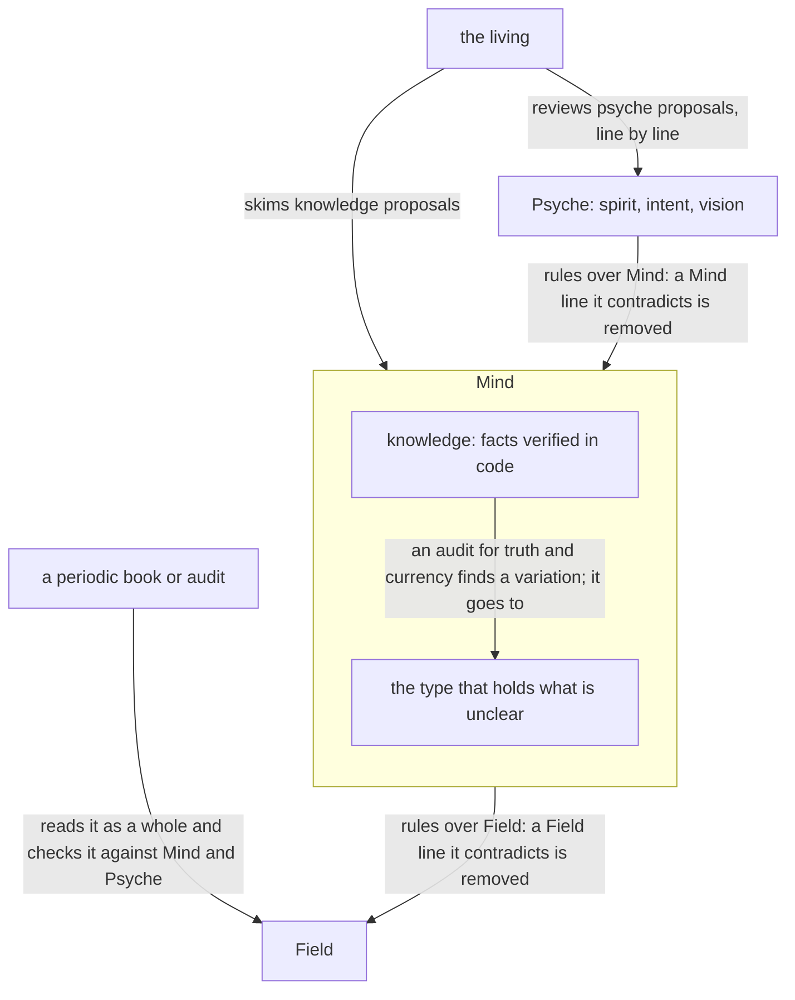
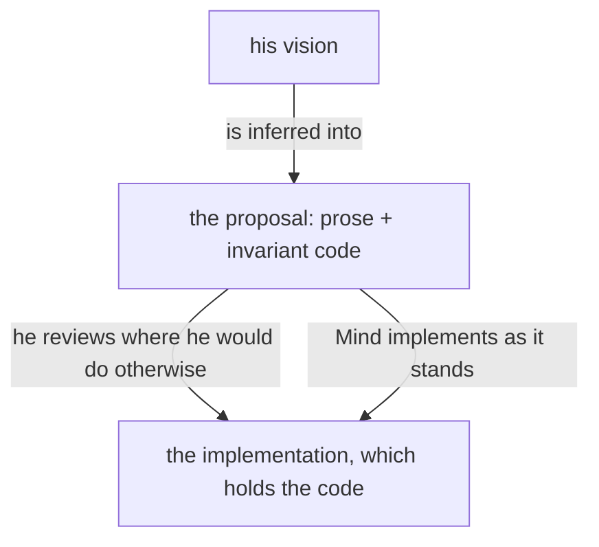
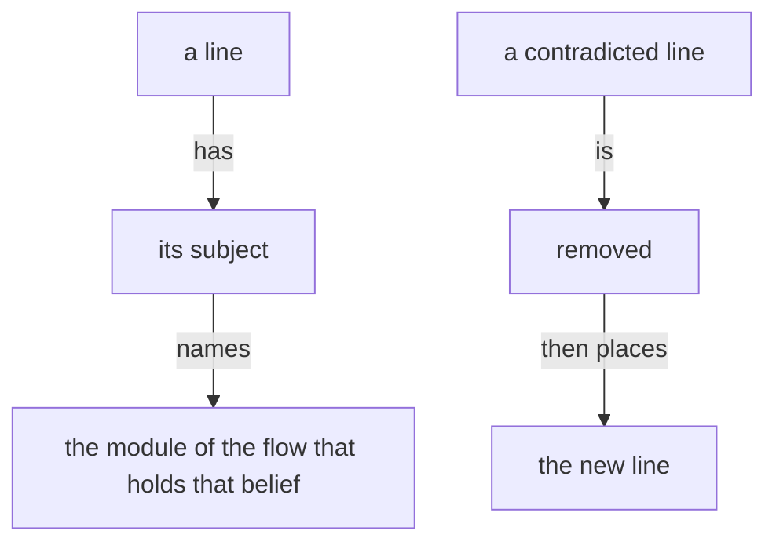
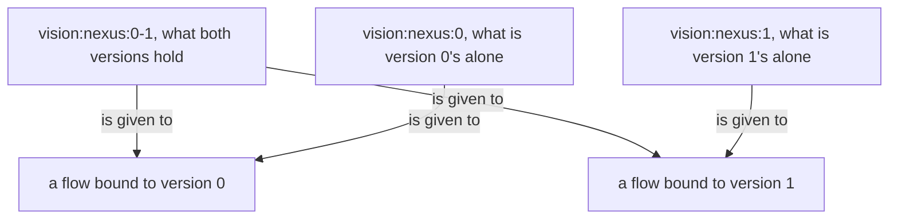

## Belief modules and their review



Knowledge modules are audited from time to time for truth and currency against practice.

A subject the living reviews or asks about has a module, on its topic or a broader one, with room to hold it.

A vision module may be substantial: it holds the code that is important to the vision, the invariant parts, which the living reviews as he reviews prose.

The code important to a vision lives in that topic's vision module.



A module declares its placement: the system prompt, or loaded on demand. A skill is the harness's interface for an on-demand module.

Spirit and intent are placed in the system prompt.

The vocabulary is context, belief modules and context building.

A context repository holds one folder per module type, each named for its type. A file is named by its version number, and its folders give its type and its topic.

## Change through the living or a mechanism

A belief module changes only on the living's approval of the line, or through a mechanism. In the long term, a change may land without his review through an extensive automated machine review held to standards.

## Context lines are richly annotated

Context lines are richly annotated, because lines of very different categories share one module and are otherwise given the same weight. Separating modules into kinds such as vision and intent is the first, crude form of that annotation.

## A belief module states what holds now

A belief module states what holds now.

## A belief module names nothing particular to his own machines

A belief module carries the mechanism, and nothing that is true of his own machines alone: no cluster name, host name, login, path or address of his. An example that needs a name uses one that is plainly an example, and says so. What is particular to his machines lives in the host's own declaration, which the module points to.

```nix
# a belief module's example: a name that
# is plainly an example
{ cluster = "example"; host = "laptop"; }
```

## A description is part of the content

A module's description is part of its content: what the description says, the body does not say again.

Every flow sees the description of every module, so a term that has a module is defined in that module's description, and the vocabulary holds only the terms that have no module.

## Editing belief

A belief goes in the module of its subject.

Removal comes before addition.



## A belief module is versioned

Every belief module is versioned, as software is. A topic's belief modules are a series of versions: a new concept starts at version 0, and what follows it is version 1. Each version has its own module, and every module's name is three fields, its type, its topic and its version number, `<type>:<topic>:<number>`; a topic with one module has it at version 0. A change to a module's lines is a revision of that version; a new number begins a version that stands beside the earlier one. A module of any type that is about one version of a thing carries that version: `vision:flow-nexus:1` says what the Flow Nexus, version 1, is to be, and `knowledge:flow-nexus:1` holds what is known of it as built.

A module may hold for a span of versions. What several versions of a topic have in common is written once, in a module whose version field is the span: `vision:nexus:0-1` holds for versions 0 and 1 of the Nexus. Each version's own module then holds only what is particular to it. A flow bound to a version is given every module of that topic whose span holds that version.

```datom
; the module registry, tentative: the versions a module holds for, then its file
{ Vision nexus [ 0 1 ] «vision/nexus/0-1.md» }   ; what both versions hold
{ Vision nexus [ 0 ] «vision/nexus/0.md» }       ; what is version 0's alone
{ Vision nexus [ 1 ] «vision/nexus/1.md» }       ; what is version 1's alone
```


