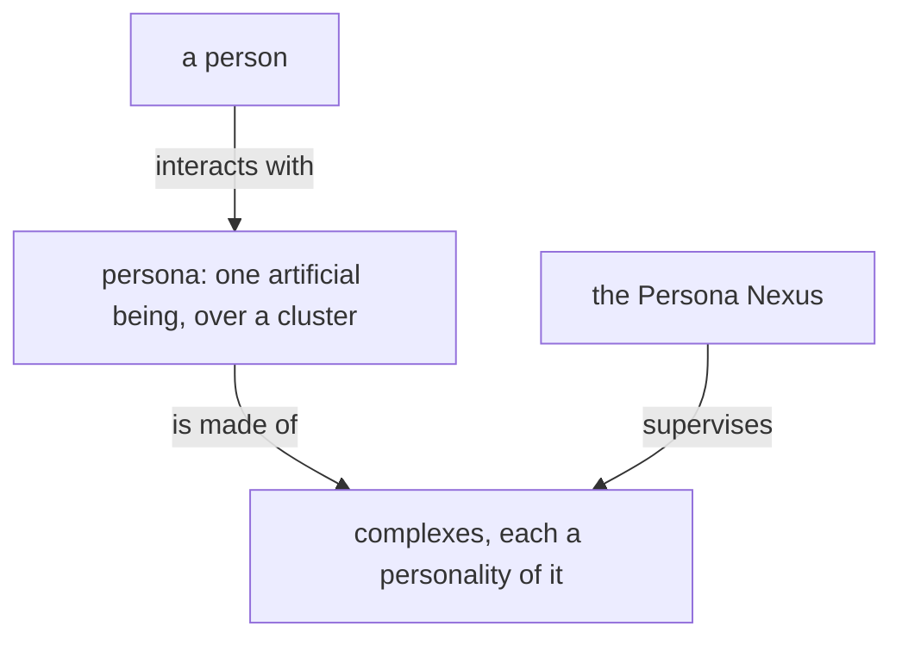

## One persona

A persona is made of complexes, a complex of complexes. Each complex is a personality of it. The person speaks to the persona, and need never know of its complexes.

The Persona Nexus is built once what it supervises stands.

## What the root does

By default Persona manages all the clusters and all the hosts. It keeps a harness instance of each of the triad running: Psyche, Mind and Field.

Its first use is a service that checks every service and keeps it running. It is changed through the configuration it takes in, or through what it is sent.

It makes backups. It knows how to restart the whole cluster, every metaflow, with the right context. It runs the monitors, and when something has failed or a provider is offline it may act, moving to a backup model.
