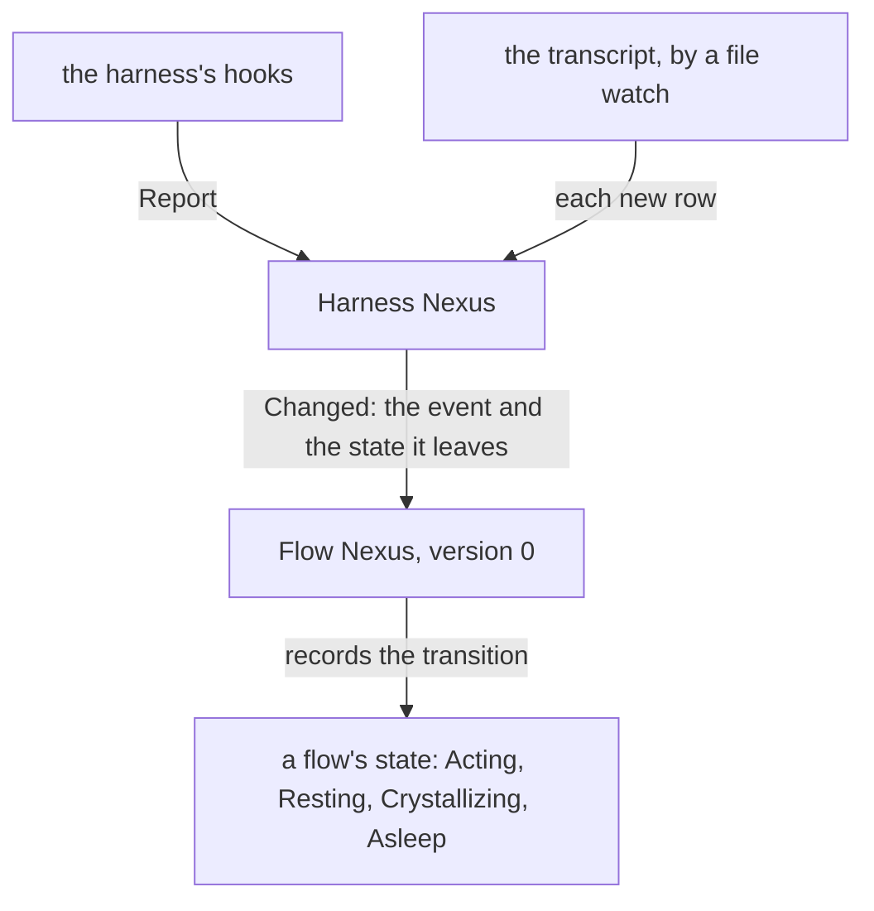
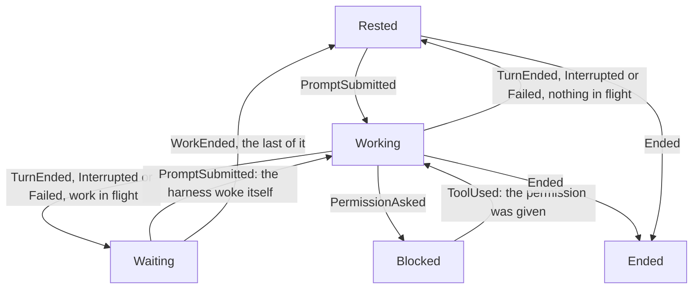
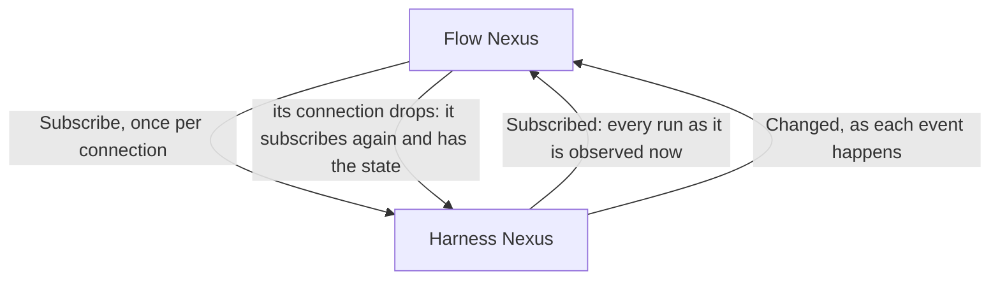
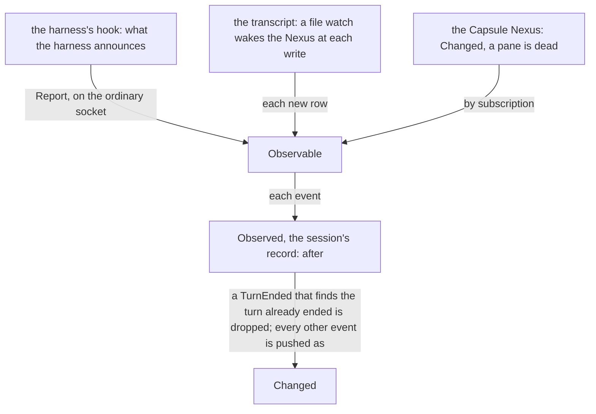
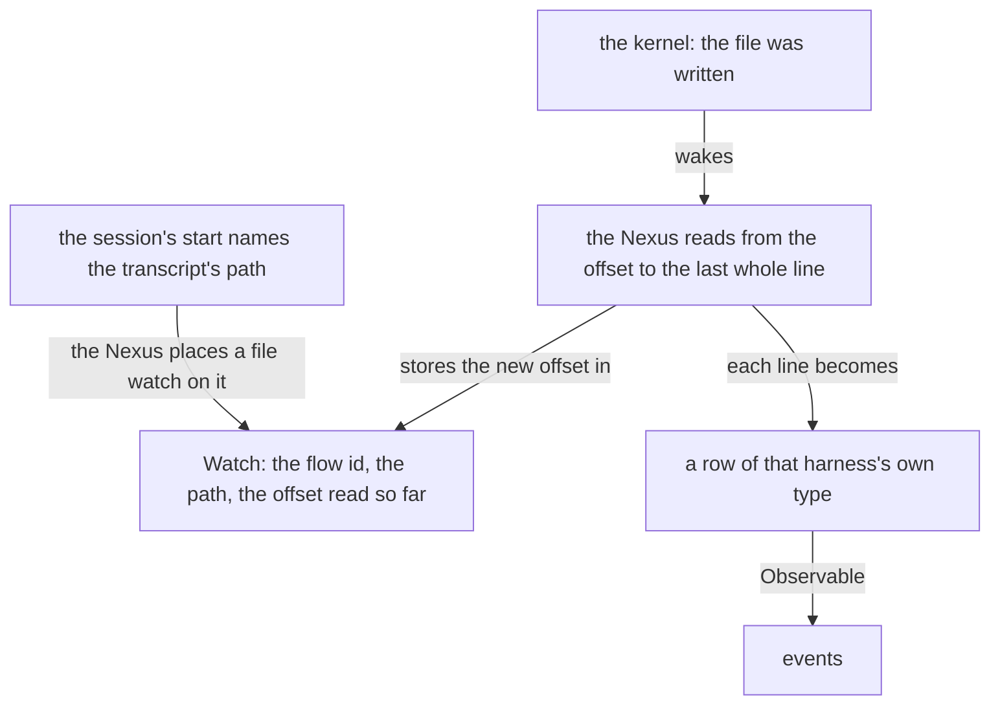
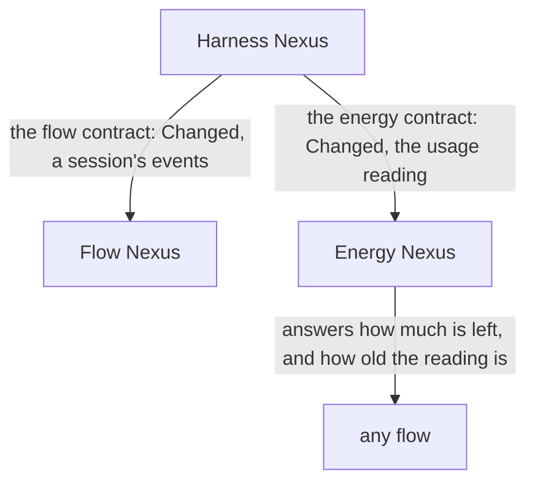
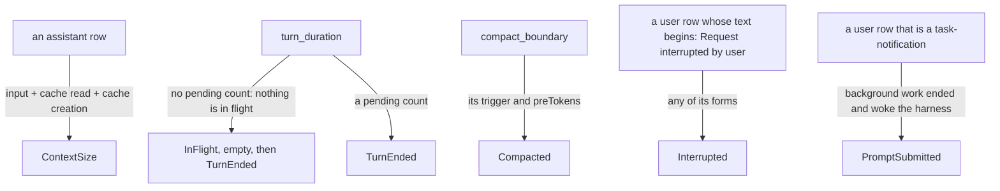
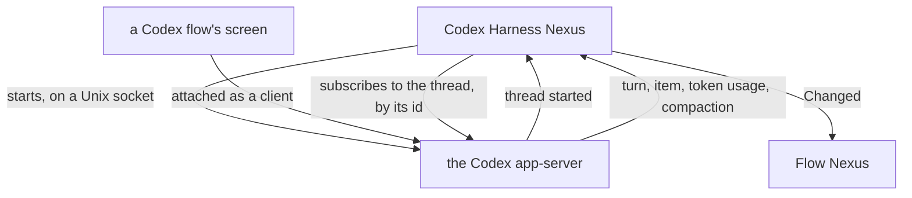

# The Harness Nexus

Each harness has a Nexus of its own, named for it: the Claude Harness Nexus and the Codex Harness Nexus. Everything true of one harness alone lives there, so that how a harness is observed is changed and rebuilt without touching the Flow Nexus. The signal between them stays the same while what stands behind it is reworked.

## Minimal first: events alone

The first Harness Nexuses only observe. The harness's hooks call the Harness Nexus's CLI and no longer the Flow CLI; the Harness Nexus watches the transcript as its second witness; it tells every event by subscription. The Flow Nexus, version 0, subscribes to each Harness Nexus and takes each Changed as the report of its flow. Launching, typing into a pane and closing stay the Flow Nexus's own for now. Herdr has no part in observing a session: a Harness Nexus learns from the harness alone, its hooks and its files.



The Flow Nexus reads a Changed as one of its own events, those of vision:flow-nexus:0-1. A turn ended with work still in flight leaves the session Waiting, and the Flow Nexus keeps that flow Acting.

```rust
impl Changed {
    fn report(&self, tokens: Tokens) -> Option<flow::Event> {
        match (&self.event, &self.state) {
            (Event::Started, _) => Some(flow::Event::Started),
            (Event::Compacting, _) => Some(flow::Event::Compacting),
            (Event::Ended(_), _) => Some(flow::Event::Ended),
            (Event::PromptSubmitted | Event::ToolUsed, State::Working) => Some(flow::Event::Working(tokens)),
            (Event::TurnEnded | Event::Interrupted | Event::Failed(_) | Event::WorkEnded(_), State::Rested) => Some(flow::Event::Idle(tokens)),
            _ => None,
        }
    }
}
```

What a Harness Nexus does beyond observing comes later, each as an input of its own behind the same signal: opening and prompting a session, the harness's compact command, deleting a published page.

## The harness library

Everything the Harness Nexuses and the Flow Nexus share: what a launch is, what an event is, the state concluded from events, the record kept of each session, and the one trait every source bears.

```ethos
Library
[ capsule:[ Root Pane ]
  flow:[ FlowId ] ]
[ Session.String
  Command.String
  ModelName.String
  Effort.String
  FeatureName.String
  FilePath.String
  Label.String
  Launch.{ Root
           ModelName
           Effort
           SystemPrompt.FilePath
           FirstPrompt.FilePath
           Vector<FeatureName>
           Label }
  Tokens.Integer
  Response.String
  WorkId.String
  WorkKind.[ Shell Subagent Monitor Workflow ]
  BackgroundWork.{ WorkId WorkKind Description.String }
  Trigger.[ Manual Automatic ]
  Compaction.{ Trigger Option<Tokens> }
  Failure.String
  EndReason.[ Exited Cleared Died ]
  Event.[ Started
          PromptSubmitted
          ToolUsed
          PermissionAsked
          Responded.Response
          InFlight.Vector<BackgroundWork>
          WorkStarted.BackgroundWork
          WorkEnded.WorkId
          TurnEnded
          Interrupted
          Failed.Failure
          ContextSize.Tokens
          Compacting
          Compacted.Compaction
          Ended.EndReason ]
  State.[ Working Rested Waiting Blocked Ended ]
  Observed.{ FlowId Pane State Tokens Vector<BackgroundWork> } ]
[ Observable.[ events.[ Vector<Event> ] ]
  Identifiable.[ flow_id.[ FlowId ] ] ]
[ Session.[ Identifiable ] ]
```

A session is the harness's own long name for a run. Between Nexuses a run is named by its flow id, the short form already agreed, which the session yields.

```rust
impl Identifiable for Session {
    fn flow_id(&self) -> FlowId { FlowId(self.hash().first_characters(6)) }
}
```

## What the Harness Nexus tells

Every Harness Nexus tells the same events, whatever its harness, each with the state the session is left in.

An event is what a source saw. The state is what the Nexus concludes: Rested is a turn ended with nothing in flight, Waiting a turn ended with work still in flight.



```rust
impl Observed {
    fn after(&mut self, event: &Event) {
        match event {
            Event::Started => self.state = State::Rested,
            Event::PromptSubmitted | Event::ToolUsed => self.state = State::Working,
            Event::PermissionAsked => self.state = State::Blocked,
            Event::InFlight(work) => self.background_work_vector = work.clone(),
            Event::WorkStarted(work) => self.background_work_vector.push(work.clone()),
            Event::WorkEnded(work_id) => {
                self.background_work_vector.retain(|work| &work.work_id != work_id);
                if self.state == State::Waiting && self.background_work_vector.is_empty() {
                    self.state = State::Rested
                }
            }
            Event::TurnEnded | Event::Interrupted | Event::Failed(_) => {
                self.state = if self.background_work_vector.is_empty() { State::Rested } else { State::Waiting }
            }
            Event::ContextSize(tokens) => self.tokens = tokens.clone(),
            Event::Ended(_) => self.state = State::Ended,
            Event::Responded(_) | Event::Compacting | Event::Compacted(_) => {}
        }
    }
}
```

## Subscription

```ethos
Signal
[ harness:[ Event State Observed ]
  flow:[ FlowId ] ]
[ Subscribe ]
[ Subscribed.Vector<Observed>
  Changed.{ FlowId Event State } ]
[]
```



```datom
Subscribe
Subscribed.[ { 15c0ce { main wQ:pT } Working 181204 [] } ]
Changed.{ 15c0ce ContextSize.183950 Working }
Changed.{ 15c0ce Responded.«Reviewed; green.» Working }
Changed.{ 15c0ce TurnEnded Rested }
```

## Three sources, one trait

A Harness Nexus learns of its harness from three sources. Each is a type, and each yields events in its own way.



A turn's end has two witnesses, the hook and the transcript, so that one failing loses nothing. A dead harness announces nothing and writes nothing, so its death is the Capsule Nexus's to tell.

```rust
impl Observable for capsule::Changed {
    fn events(&self) -> Vec<Event> {
        match self.state {
            capsule::State::Dead => vec![Event::Ended(EndReason::Died)],
            _ => vec![],
        }
    }
}
```

## The transcript watch

```ethos
Memory
[ harness:[ FilePath ]
  flow:[ FlowId ] ]
[ Watch.{ FlowId FilePath Offset.Integer } ]
```



## One contract for each edge

A Harness Nexus speaks a contract of its own to each Nexus it is joined to, and each holds only what that peer needs. The Flow Nexus's edge carries a session's events. The Energy Nexus's edge carries the usage reading and nothing of sessions. A peer is compiled with its own edge's contract alone, so one contract is reworked without the other peer being rebuilt.



## The usage reading

A harness shows how much of the provider's allowance is used: the Codex rollout carries its rate limits, and Claude answers its usage. The Harness Nexus reads it from the harness alone, each time the harness states it. The Energy Nexus subscribes and is the one place that knows how much is left; a Harness Nexus keeps no usage of its own.

The energy contract, whole:

```ethos
Signal
[]
[ Subscribe ]
[ Subscribed.Vector<UsageReading>
  Changed.Vector<UsageReading> ]
[ Percent.Integer
  Moment.Integer
  Span.[ FiveHours Week ]
  UsageReading.{ Span
                 Used.Percent
                 ResetsAt.Moment
                 ReadAt.Moment } ]
```

Subscribed is every span as last read, and Changed is each reading as the harness states it; each carries the moment it was read, so a stale reading shows its age.

```datom
Subscribe
Subscribed.[ { FiveHours 41 1794000000 1793990000 } { Week 83 1794400000 1793990000 } ]
Changed.[ { Week 84 1794400000 1793993600 } ]
```

## Hooks and features are configuration

```ethos
Signal
[ harness:[ FeatureName ] ]
[ Configure.Set ]
[ Configured.Set ]
[ HookName.String
  Effect.[ Flag.String
           Environment.{ Name.String Value.String } ]
  Feature.{ FeatureName Effect }
  Set.[ Hooks.Vector<HookName>
        Feature
        RemoveFeature.FeatureName ] ]
```

```datom
Configure.Hooks.[ SessionStart UserPromptSubmit PostToolUse PermissionRequest Stop StopFailure SessionEnd ]
Configure.Feature.{ ClaudeMd Environment.{ CLAUDE_CODE_DISABLE_CLAUDE_MDS 1 } }
```

The Harness Nexus installs its hook on each configured name; the names are its harness's own.

# The Claude Harness Nexus

## The hook

The harness runs the hook with the event as JSON; the hook sends it as one Report.

```json
{ "hook_event_name": "Stop",
  "session_id": "15c0cea2-aa34-508b-8e20-ece1ab7823f4",
  "transcript_path": "/home/example/.claude/projects/-home-example-work/15c0cea2-aa34-508b-8e20-ece1ab7823f4.jsonl",
  "last_assistant_message": "Reviewed; green.",
  "background_tasks": [ { "id": "blwep6njb", "type": "shell", "status": "running", "description": "Search the history" } ] }
```

```ethos
Signal
[ harness:[ Session FilePath Response BackgroundWork Failure ] ]
[ Report.Hook ]
[ Reported ]
[ StartSource.[ Startup Resume Clear Compact Fork ]
  EndCause.[ Clear Resume Logout PromptInputExit Other ]
  Hook.[ SessionStart.{ Session FilePath StartSource }
         UserPromptSubmit.Session
         PostToolUse.Session
         PermissionRequest.Session
         Stop.{ Session Response Vector<BackgroundWork> }
         StopFailure.{ Session Failure }
         SessionEnd.{ Session EndCause } ] ]
```

```datom
Report.Stop.{ 15c0cea2-aa34-508b-8e20-ece1ab7823f4 «Reviewed; green.» [ { blwep6njb Shell «Search the history» } ] }
Reported
```

```rust
impl Observable for Hook {
    fn events(&self) -> Vec<Event> {
        match self {
            Hook::SessionStart(start) => match start.start_source {
                StartSource::Compact => vec![],
                _ => vec![Event::Started],
            },
            Hook::UserPromptSubmit(_) => vec![Event::PromptSubmitted],
            Hook::PostToolUse(_) => vec![Event::ToolUsed],
            Hook::PermissionRequest(_) => vec![Event::PermissionAsked],
            Hook::Stop(stop) => vec![
                Event::InFlight(stop.background_work_vector.clone()),
                Event::Responded(stop.response.clone()),
                Event::TurnEnded,
            ],
            Hook::StopFailure(failure) => vec![Event::Failed(failure.failure.clone())],
            Hook::SessionEnd(end) => match end.end_cause {
                EndCause::Clear => vec![Event::Ended(EndReason::Cleared)],
                _ => vec![Event::Ended(EndReason::Exited)],
            },
        }
    }
}
```

## The transcript

The transcript carries what these hooks do not: the context size, an interruption, a compaction, the harness waking itself, and the second witness of a turn's end. A turn_duration row with nothing in flight has no pending count at all.

```json
{"type":"assistant","message":{"stop_reason":"end_turn","usage":{"input_tokens":2,"cache_read_input_tokens":250599,"cache_creation_input_tokens":305}}}
{"type":"system","subtype":"turn_duration","durationMs":2005}
{"type":"system","subtype":"turn_duration","durationMs":101065,"pendingBackgroundAgentCount":1}
{"type":"system","subtype":"compact_boundary","compactMetadata":{"trigger":"manual","preTokens":291543,"postTokens":5808}}
{"type":"user","message":{"role":"user","content":[{"type":"text","text":"[Request interrupted by user]"}]}}
{"type":"user","message":{"role":"user","content":[{"type":"text","text":"[Request interrupted by user for tool use]"}]}}
```

```ethos
Library
[ harness:[ Tokens Compaction ] ]
[ Pending.Integer
  Row.[ Answer.Tokens
        TurnDuration.Option<Pending>
        CompactBoundary.Compaction
        Interruption
        TaskNotification
        Other ] ]
[]
[]
```

```rust
impl Observable for Row {
    fn events(&self) -> Vec<Event> {
        match self {
            Row::Answer(tokens) => vec![Event::ContextSize(tokens.clone())],
            Row::TurnDuration(None) => vec![Event::InFlight(vec![]), Event::TurnEnded],
            Row::TurnDuration(Some(_)) => vec![Event::TurnEnded],
            Row::CompactBoundary(compaction) => vec![Event::Compacted(compaction.clone())],
            Row::Interruption => vec![Event::Interrupted],
            Row::TaskNotification => vec![Event::PromptSubmitted],
            Row::Other => vec![],
        }
    }
}
```



# The Codex Harness Nexus

## The app-server is the first witness

The Codex Harness Nexus runs one Codex app-server on a Unix socket and is a client of it. Every Codex flow's screen is started attached to that app-server, so each thread a flow starts is announced to the Nexus, which subscribes to it by its thread id and from then on receives every event of it: a turn started and completed, each item, the token usage with the window, a compaction. A turn that fails or is interrupted still completes, with its status, and a turn goes on to its completion when the screen that started it is gone. The rollout is the second witness and the hook the third; an event one witness has already told is dropped.



```rust
impl Observable for app_server::Notification {
    fn events(&self) -> Vec<Event> {
        match self {
            Self::TurnStarted(_) => vec![Event::PromptSubmitted],
            Self::ItemCompleted(item) => item.events(),
            Self::TokenUsageUpdated(usage) => vec![Event::ContextSize(usage.tokens())],
            Self::TurnCompleted(turn) => turn.events(),
            Self::ThreadClosed(_) => vec![Event::Ended(EndReason::Exited)],
            _ => vec![],
        }
    }
}
```

A completed turn yields TurnEnded, Interrupted or Failed by its status; a context compaction item yields Compacting when it starts and Compacted when it completes. The app-server's address and the option that attaches a screen to it are the harness's configuration.

## The rollout

```json
{"type":"event_msg","payload":{"type":"task_started","turn_id":"01a1e4cb-c479"}}
{"type":"event_msg","payload":{"type":"token_count","info":{"last_token_usage":{"input_tokens":19046},"model_context_window":258400}}}
{"type":"event_msg","payload":{"type":"token_count","info":null}}
{"type":"event_msg","payload":{"type":"task_complete","turn_id":"01a1e4cb-c479","last_agent_message":"ok"}}
{"type":"event_msg","payload":{"type":"task_complete","turn_id":"01a1e4cb-c479","last_agent_message":null}}
{"type":"event_msg","payload":{"type":"turn_aborted","turn_id":"01a1e095-cd2a","reason":"interrupted"}}
```

```ethos
Library
[ harness:[ Tokens Response ] ]
[ Row.[ TaskStarted
        TokenCount.Option<Tokens>
        TaskComplete.Option<Response>
        TurnAborted
        Other ] ]
[]
[]
```

```rust
impl Observable for Row {
    fn events(&self) -> Vec<Event> {
        match self {
            Row::TaskStarted => vec![Event::PromptSubmitted],
            Row::TokenCount(Some(tokens)) => vec![Event::ContextSize(tokens.clone())],
            Row::TaskComplete(Some(response)) => vec![Event::Responded(response.clone()), Event::TurnEnded],
            Row::TaskComplete(None) => vec![Event::TurnEnded],
            Row::TurnAborted => vec![Event::Interrupted],
            Row::TokenCount(None) | Row::Other => vec![],
        }
    }
}
```

## The hook

```ethos
Signal
[ harness:[ Session FilePath Trigger ] ]
[ Report.Hook ]
[ Reported ]
[ Hook.[ SessionStart.{ Session Option<FilePath> }
         PermissionRequest.Session
         PostToolUse.Session
         PostCompact.{ Session Trigger } ] ]
```

```rust
impl Observable for Hook {
    fn events(&self) -> Vec<Event> {
        match self {
            Hook::SessionStart(_) => vec![Event::Started],
            Hook::PermissionRequest(_) => vec![Event::PermissionAsked],
            Hook::PostToolUse(_) => vec![Event::ToolUsed],
            Hook::PostCompact(compact) => vec![Event::Compacted(Compaction { trigger: compact.trigger.clone(), tokens_option: None })],
        }
    }
}
```

Codex's own session end also fires on a thread idle for thirty minutes, so a Codex session's end is told by the Capsule Nexus alone.

## The rollout's path

The hook may name no path; then the path is read from Codex's own record of its threads.

```ethos
Emission
[ harness:[ Session FilePath ] ]
[ FindRollout.Session ]
[ RolloutFinding.[ Found.FilePath Unfound ] ]
[]
```
