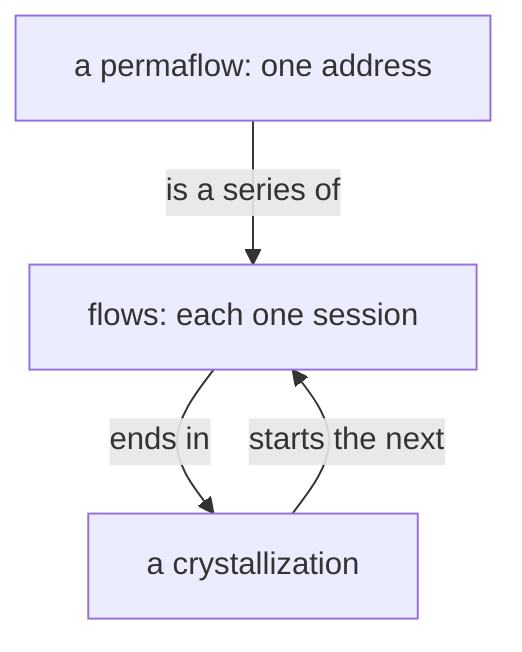
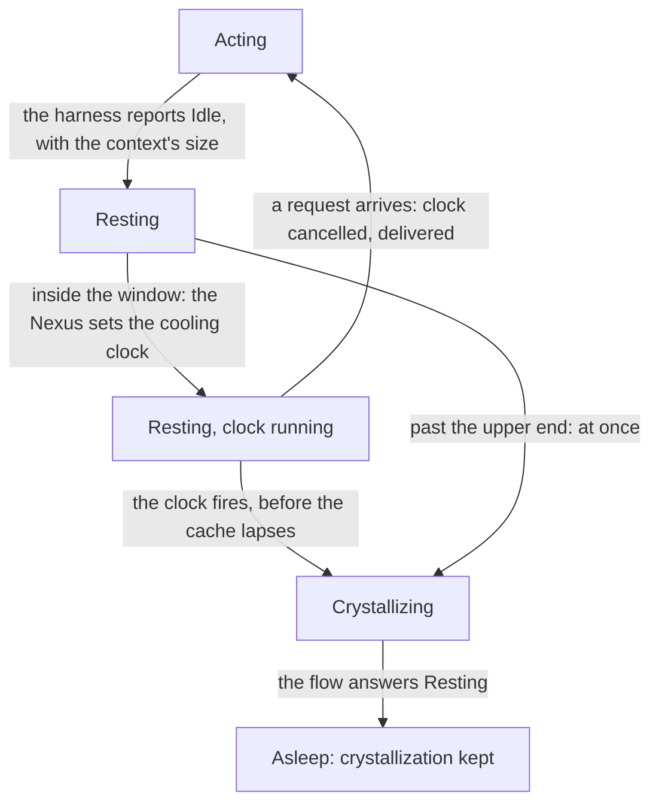
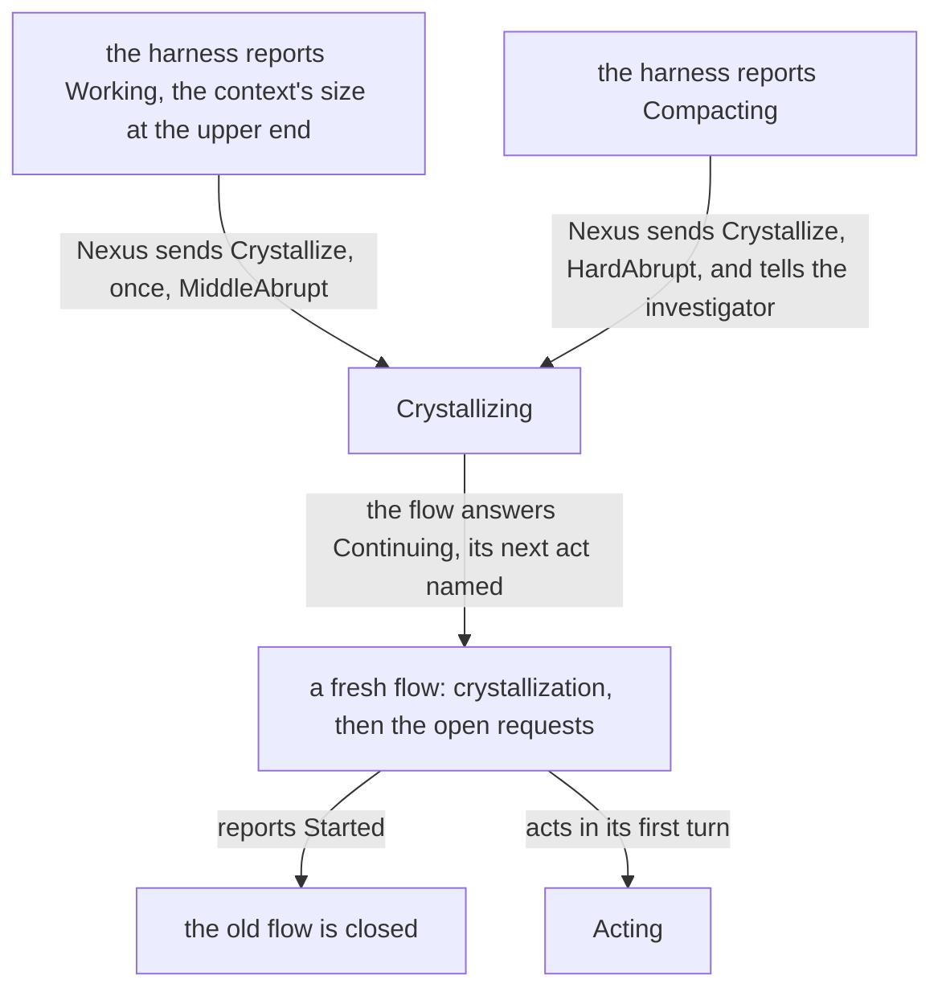
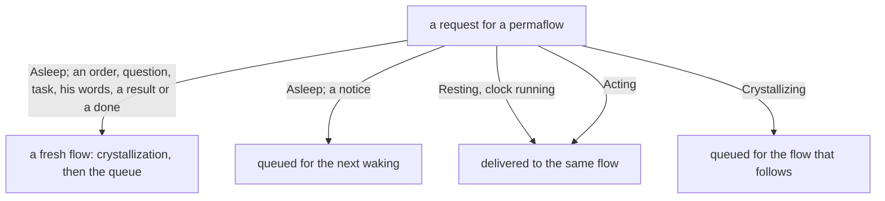
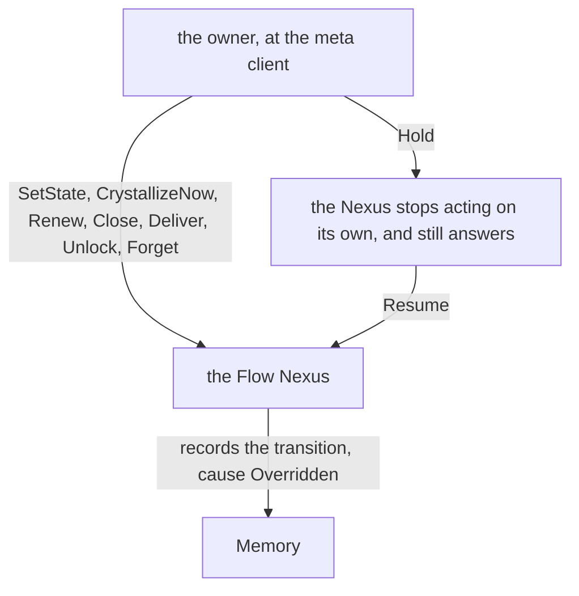

A launch can be rehearsed: the same input, asked as a dry run, answers with the whole command the Flow Nexus would run and runs nothing. From that command an agent starts the flow by hand, changed however the Flow Nexus does not yet support. The answer is one string, the command line as the shell is to receive it, quoted for the shell inside.

One call sends several requests to one receiver, and they reach it together, in one prompt, in the order written: his words and the order about them arrive as one thing, and the sender pays for one call.

## A flow is a thought flow

A flow is a thought flow of a thinking machine, one session of it in a harness. A permaflow is the series of flows under one address, and the thought continues through the series: each flow ends in a crystallization and the next starts from it. A flow with a goal unachieved is acting; a flow with none is resting.



## The efficient window

Each model has an efficient window: the size of context within which a flow is worth continuing. Its upper end is set below the size at which the harness compacts on its own. A flow goes cold when its cache life has passed since its last turn. The window, the cache life and the margin are configuration, one record per model; the investigator is the address told of what went wrong.

```ethos
Library
[ flow:[ Model Address ModuleName ] ]
[ Tokens.Integer
  Minutes.Integer
  EfficientWindow.{ Model
                    UpperEnd.Tokens
                    CacheLife.Minutes
                    CoolingMargin.Minutes }
  CrystallizationGuide.{ Address ModuleName }
  Investigator.Address ]
[]
[]
```

A CrystallizationGuide names, for one permaflow, the module that says how its kind of flow crystallizes. The figures and the module name below are examples.

```datom
EfficientWindow.{ Sol 150000 60 5 }
CrystallizationGuide.{ { Mind flowNexus Sol } knowledge:crystallization-implementer:0 }
Investigator.{ Psyche core Opus }
```

## A flow's state is a record of events

The Flow Nexus holds a flow's state as the last of its transitions, each recorded with the event that caused it, for every harness alike. The harness reports that a turn began, each tool boundary with the context's size, and the rest with the context's size; the Flow Nexus's own clock and the requests it delivers are causes as well.

```ethos
Memory
[ flow:[ FlowId Address RequestId ] ]
[ Tokens.Integer
  Moment.Integer
  NextAct.String
  Onward.[ Continuing.NextAct
           Resting ]
  Event.[ Started
          Working.Tokens
          Idle.Tokens
          Compacting
          Ended ]
  Cause.[ Reported.Event
          CoolingDue
          Arrived.RequestId
          Crystallized.Onward
          Overridden ]
  State.[ Acting Resting Crystallizing Asleep ]
  Transition.{ State Cause Moment }
  Flow.{ FlowId Address Vector<Transition> } ]
```

## A resting flow crystallizes before it goes cold, and sleeps

When a flow comes to rest inside its window, the Flow Nexus sets one clock, the cooling margin short of the cache life, and sends the flow nothing. A request that arrives is delivered and cancels the clock. When the clock fires, or at once when the flow rests past the upper end, the Flow Nexus asks the flow to crystallize, once, with its guide's text in the same prompt. The flow answers that it rests, and the permaflow is asleep: its crystallization is kept for its next flow. An OnDemand permaflow's harness is closed; a Maintained one's pane stays on screen for the living to read.



The Flow Nexus asks, and the flow answers; the request names the guide and the file to write.

```ethos
Signal
[ flow:[ RequestId ModuleName Onward ] ]
[ Crystallized.{ RequestId Onward } ]
[ Slept
  Continued ]
[ FilePath.String
  Crystallize.{ RequestId ModuleName FilePath } ]
```

```datom
[ { Notification MiddleAbrupt.Crystallize.{ c4d1 knowledge:crystallization-implementer:0 «flows/5441e0/crystallization.md» } } ]
Crystallized.{ c4d1 Resting }
Slept
```

## An acting flow continues in a fresh flow

When an acting flow's context reaches the upper end of its window, the Flow Nexus asks it to crystallize, once, at its next tool boundary. The flow finishes what it has in hand, crystallizes with its goal and its next act, and answers that it continues; the Flow Nexus starts a fresh flow of the same permaflow from that crystallization and the open requests, and closes the old flow when the new one reports Started. No flow is ended for its size alone.

When the harness announces a compaction, the Flow Nexus asks for the crystallization then, pressing, and tells the investigator; crystallization is the flow's own compaction, made by its kind's guide.



```datom
Crystallized.{ c4d1 Continuing.«Run the codec tests, then mend the two that fail.» }
Continued
```

A flow started to continue acts in its first turn. One that reports Idle after Started with no Working between them is a useless refresh, and the investigator is told.

## What wakes a sleeping permaflow

A request for a sleeping permaflow starts a fresh flow from its crystallization, with its queue, oldest first; a notice alone waits for the next waking. A resting flow whose clock still runs is hot and inside its window, and receives the request itself. A cold flow is never woken.



## The override panel

Whatever the Flow Nexus holds or does on its own can be set or done by hand on the meta socket, so that a fault is worked through the Nexus and never around it. Each override is recorded as a transition with its cause, Overridden. Hold is the shutdown switch: the Flow Nexus stops acting on its own, its clocks, its deliveries and its launches, and still answers; Resume lets it act again.

```ethos
Signal
[ flow:[ FlowId Address State ] ]
[ SetState.{ FlowId State }
  CrystallizeNow.FlowId
  Renew.Address
  Close.FlowId
  Deliver.Address
  Unlock.Address
  Forget.FlowId
  Hold
  Resume ]
[ StateSet.{ FlowId State }
  Asked.FlowId
  Renewed.FlowId
  Closed.FlowId
  Delivered.Address
  Unlocked.Address
  Forgotten.FlowId
  Held
  Resumed
  Refused.[ UnknownFlow.FlowId
            UnknownAddress.Address ] ]
[]
```

SetState corrects the state the Nexus holds for a flow; CrystallizeNow asks a flow for its crystallization whatever its state; Renew starts a fresh flow of a permaflow from its crystallization and closes the old one; Close closes a flow's harness; Deliver hands a permaflow its queue now; Unlock releases a permaflow's lock; Forget removes the record of a flow that has no harness.



The flow that was held as working, corrected and renewed through the Nexus:

```datom
SetState.{ 5441e0 Resting }
StateSet.{ 5441e0 Resting }
Renew.{ Mind flowNexus Sol }
Renewed.918fa4
```
