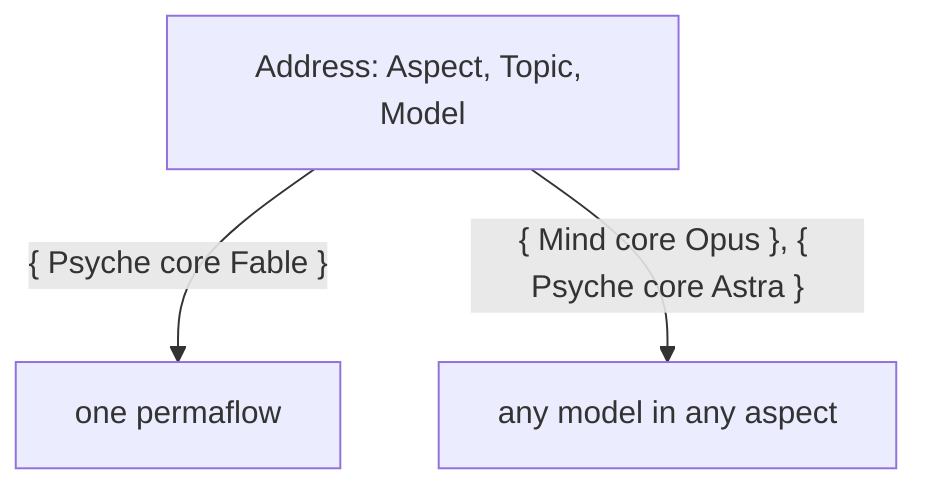
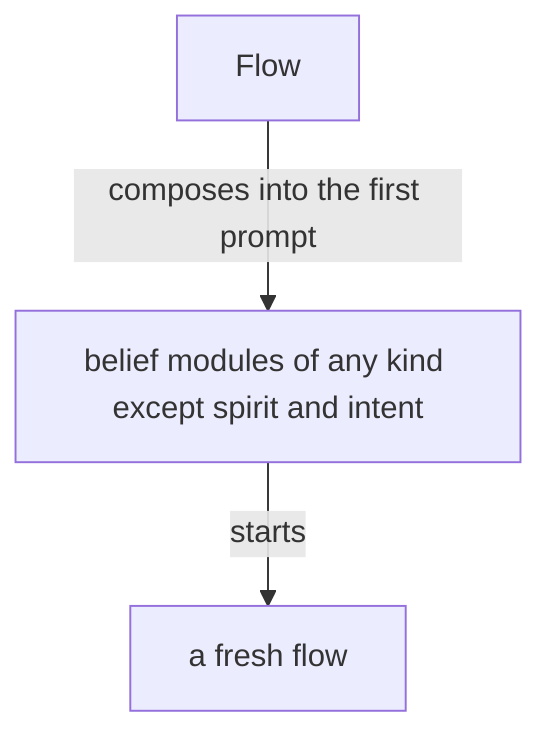
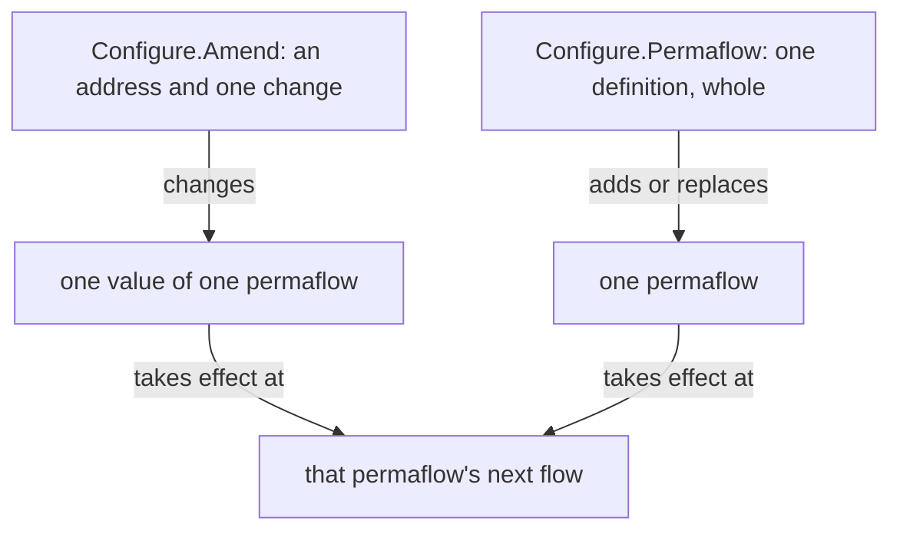
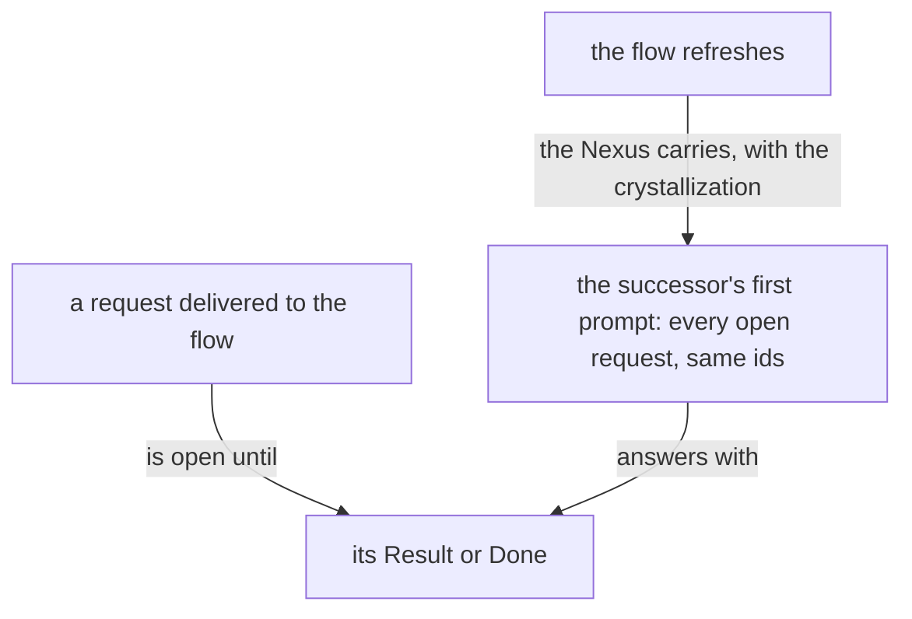

## What it does



The Flow Nexus sets up and starts a model flow: its working
directory, system prompt, training files and instruction prompt.

The Flow Nexus is the Nexus that manages flows. A flow is one run of a permaflow; the component is named for what it manages. A flow the living asks for is launched, properly and surely. The Flow Nexus holds the lock on flows.

The Flow Nexus is for starting flows cheaply: clean flows, specialized flows and refreshed flows, each with a clean on-point context, which yields higher-quality output. A flow is taken down as easily as it is started. Starting flows is the cornerstone of the system.

A flow runs one model, linear and very limited. An agent is a whole being, a lot more than that. Many flows, properly structured and orchestrated, together resemble a synthetic intelligence, synthesized from human knowledge and mathematical probability.

The Capsule is the component that makes where a flow runs. Its first embodiment is the semi-sandbox: only the credential files are copied, everything else is recreated, with its own sockets and store, running light models.

Herdr is one backend of the Capsule, the component that gives a flow its place to run; the backend may be exchanged.

The Flow Nexus manages permaflows. A permaflow is one address, { Aspect Topic Model }, that continues through several flows one after another; the flow is its current run. The default topic is core: the permanent topic, the thing that keeps the machine going, the last topic to stand.

A topic is an open enum: the constant topics, core among them, are fixed, and the users and the machine extend the set with camelCase identifiers.

A topic's name is a camelCase identifier, uncapitalized. A flow's id is the hash of the harness's session id, kept to six characters and lengthened when two collide, so a transcript is found from the flow id. Every call to the Flow Nexus is identified by the calling process. Anybody may call the Flow Nexus, a flow for its own refresh among them: because the CLI checks the calling process, a flow refreshes itself safely.

In the chat a flow is named by its permaflow, and the flow id almost disappears from it; the id is for the ledger and for finding the transcript.

A request reaching a permaflow is one of a closed set of types, SendableRequest below, each with its waking effect. A flow sends a request through the Flow Nexus, which owns the lock and the delivery and answers sent or queued. A permaflow whose next flow is being started queues what arrives until that flow has started, while the Flow Nexus keeps serving every other request.

```ethos
SendableRequest.[ Order.String
                  Question.String
                  Living.{ Context.String
                           Verbatim.String }
                  Result.{ RequestId String }
                  Notice.String
                  Task.AnswerableTask
                  Done.{ RequestId String } ]
RequestId.String
AnswerableTask.{ Minutes String }
Minutes.Integer
SendableMessage.[ HardAbrupt.SendableRequest
                  MiddleAbrupt.SendableRequest
                  Soft.SendableRequest ]
```

An Order is a request, what the recipient is to act on; a Living is what his words were about and his words whole; a Result answers the order of that id and a Done closes the task of that id; a RequestId is four characters, minted by the Nexus; an AnswerableTask is a task with the minutes it is given; and the priority is a head on the request.

A request is written without an id and delivered with one: the Nexus mints it, four characters, as a bead has, and places it as the first field of the request it delivers. The delivered request is its own type, the sent request with its id in it. A Result or a Done names that id and nothing of the request's text; the answerer spends no output repeating it, and the receiver's context holds its own words once. The reply to a Send carries the id the Nexus minted, so the sender knows which Result or Done answers it.

```ethos
DeliveredRequest.[ Order.{ RequestId String }
                   Question.{ RequestId String }
                   Task.{ RequestId Minutes String }
                   Notice.{ RequestId String } ]
Sent.RequestId
```

A DeliveredRequest is the sent request with the id the Nexus gave it, and Sent is the reply to a Send: the id the Nexus minted.

Below, a request is sent, delivered and answered, in that order.

```datom
Send.{ Address.{ Mind core Secondary } Soft.Order.«Review the drain fix.» }
Sent.{ k7ph }
{ Sender.{ Psyche core Primary } Soft.Order.{ k7ph «Review the drain fix.» } }
Send.{ Address.{ Psyche core Primary } Soft.Result.{ k7ph «Reviewed; green.» } }
```

```datom
Send.{ Address.{ Psyche core Opus } Soft.Living.{ «context» «verbatim» } }
```

```ethos
Signal
[ flow:[ Address SendableMessage RequestId ] ]
[ SendSeveral.{ Address Vector<SendableMessage> } ]
[ SentSeveral.Vector<RequestId> ]
[]
```

SendSeveral is an added input, several messages delivered together, and SentSeveral an added output, the id of each in the order written.

The call below carries his words and the order about them, one call and one prompt for the receiver.

```datom
SendSeveral.{ { Psyche core Opus }
              [ Soft.Living.{ «the margin of a landed change» «Make it a double margin.» }
                Soft.Order.«Build a trial of it on one page, landing nothing.» ] }
SentSeveral.[ b7q4 9m34 ]
```

Putting a permaflow to sleep and waking it is a dangerous design: done improperly it destroys the machine's energy, which is death.
A flow that starts fresh reads everything its work needs before it works; a permaflow sleeps on its crystallization, which is what spares its next flow that reading.

What has been queued for an idle permaflow, the vision touching its topic among it, is injected with the request that wakes it, so the flow knows it as soon as it wakes.
A permaflow wakes when a request needs it; what touches its topic queues until then.

The Flow Nexus exposes everything from the harness, the bare input: a flow is started, stopped and sent a message through the Flow Nexus, the one send path.

The flow that finishes messages the flow that needs to know.

## A message

A message is a datom and lands in the recipient's prompt as one; the datom is the whole message. Its priority is a head on the request: HardAbrupt, MiddleAbrupt or Soft. A pressing message wakes its recipient; a message that only queues carries what may wait. A message is addressed to a permaflow and reaches the flow running when it arrives; a request to deliver a recipient's queue delivers every queued message, or nothing when none is queued.

A message carries what its reader acts on: what the sender intends, or what it has done. It carries no hash: a flow is named by its permaflow, a book by its title, a commit by what it landed.

Inducing an interrupt, placing prompt text, submitting it, and the recipient consuming it are four separate observations. None of them stands for another, and a submission is never a read receipt.

A task carries the minutes it is expected to take; the Flow Nexus reminds the sender when they pass, and the done reply names the task and cancels the reminder. A receiver going idle with a task open fires a notice to the flow waiting on it, so that nothing is forgotten. Any flow asks the Flow Nexus for a reminder after a number of minutes.

## Starting flows

A Nexus component decides the system prompt and everything about a
launch, replacing the harness's subagents with specialized harnesses
launched with specialized system prompts.

The address names the model, Fable, Opus, Sonnet, Haiku, Astra, Sol, Luna or Terra, in every aspect: a Psyche core Astra and a Mind core Fable are both addresses. A launch names the permaflow, the belief modules composed into its prompts, and a brief of a small paragraph; the Nexus composes the prompt from its module registry.

The Flow Nexus's configuration holds, for each permaflow, its purpose, beside its modules; the Flow Nexus composes them with the brief into the first prompt, and the instruction for the first response belongs to that composition.

A fresh flow's first prompt carries the belief modules relevant to it, of any kind except spirit and intent, which sit in the system prompt.



A fresh flow starts with every belief module its permaflow is bound to, all loaded at its start: much of it in its system prompt, the rest in its first prompt, or in as many prompts as it takes, sent one right after another, so that its start is one model call.

A simplified flow is a kind of flow made for judgment alone: it starts with a system prompt of its own, it has no regular tool, and its response is its message.

A flow is specified whole, in Datom, by a domain-specific language in Ethos: its system prompt, its default belief modules and its variations. The flow ethos holds the specification.

The system prompt is composed of modules of several types, and what a harness calls a skill overlaps with them.
Its anatomy is drawn up in ethos from a study of system prompts of every kind, each line placed by what it is and by the kind of guidance it belongs to.
Where the harness allows it, a part of a main flow's system prompt is the main flow's alone and is not passed down to its subagents.

Every flow has a topic; a flow with no special topic has the topic core, the heart of its aspect. A topic is a core:Name, a camelCaseExpression checked when created. A flow's title is one datom struct of its aspect, topic, model and flow id: `{ Psyche core Opus <id> }`.

Who speaks to whom is vision:aspects:0'. Version 0 refuses no request by its address; the routes are version 1's, in the complex definition.

```
[ Launch.LaunchRequest
  Rehearse.LaunchRequest ]
[ Launched.FlowId
  Rehearsed.Command.String ]
```

Rehearsed is the shell command, whole.

```
Rehearse.{ { Psyche core Fable } «brief» }
Rehearsed.«herdr --session main agent start … -- --dangerously-skip-permissions --system-prompt-file /…/bundle --model … --effort …»
```

A harness is described in configuration: every feature it has, and what leaving that feature out does to the launch, a flag or a variable. The Nexus holds no feature and no effect of its own; it reads the effect from the declaration and composes the launch from the names a permaflow lists. A new harness, or a new version of one, is a new declaration. Where two features share one flag, the composition emits that flag once, with the names merged.

A permaflow is one definition: everything the Flow Nexus holds about one address is in it. Configuration changes one value at a time: one permaflow is added, replaced or removed alone, and one value of one permaflow, a module among them, is changed alone, by naming the address and the value. The change takes effect at the permaflow's next flow.



```ethos
Library
[ flow:[ Address ] ]
[ HarnessName.[ Claude Codex ]
  FeatureName.String
  Effect.[ Flag.String
           Environment.{ Name.String
                         Value.String } ]
  Feature.{ FeatureName Effect }
  Harness.{ HarnessName
            Features.Vector<Feature> }
  Root.String
  ModuleName.String
  Purpose.String
  Kind.[ Regular Simplified ]
  Continuity.[ Maintained
               OnDemand ]
  Permaflow.{ Address
              Option<Root>
              HarnessName
              LeaveOuts.Vector<FeatureName>
              SystemModules.Vector<ModuleName>
              PromptModules.Vector<ModuleName>
              Purpose
              Kind
              Continuity } ]
[]
[]
```

A HarnessName names a harness and a FeatureName a feature; an Effect is what leaving the feature out does to the launch, a Flag or an Environment variable set for the harness alone, and a Harness is the declaration of every feature it has. Root is the flow's working directory, a ModuleName is a belief module by its name, type, topic and version, and a Purpose is what the permaflow is for, composed into its first prompt. A simplified Kind judges alone, with no regular tool, and Continuity is Maintained, always a running flow, or OnDemand, asleep until a request wakes it. A Permaflow's SystemModules are composed into the system prompt and its PromptModules into the first prompt.

```ethos
Signal
[ flow:[ Address Root HarnessName FeatureName ModuleName
         Purpose Kind Continuity Permaflow Harness ] ]
[ Configure.Set ]
[ Configured.Set
  ConfigureRefused.[ UnknownPermaflow.Address
                     UnknownHarness.HarnessName
                     UnknownFeature.FeatureName
                     UnknownModule.ModuleName ] ]
[ Set.[ Permaflow
        RemovePermaflow.Address
        Harness
        RemoveHarness.HarnessName
        Amend.{ Address Change } ]
  Change.[ Workspace.Option<Root>
           HarnessName
           Purpose
           Kind
           Continuity
           Add.Element
           Remove.Element ]
  Element.[ SystemModule.ModuleName
            PromptModule.ModuleName
            LeaveOut.FeatureName ] ]
```

Configure takes one change at a time, and Configured answers the change made. A Set is one permaflow, whole, added or replaced, one harness, whole, added or replaced, or an Amend of one value of one permaflow; a Change is a single value replaced, or an element appended to its list or removed from it.

The first line below adds one module to one permaflow and the second is its answer; the third sets its purpose; the fourth removes one permaflow.

```datom
Configure.Amend.{ { Psyche core Fable } Add.PromptModule.vision:energy-nexus:1 }
Configured.Amend.{ { Psyche core Fable } Add.PromptModule.vision:energy-nexus:1 }
Configure.Amend.{ { Psyche core Fable } Purpose.«Designs with the living.» }
Configure.RemovePermaflow.{ Psyche book Haiku }
```

```datom
Configure.Harness.{
   Claude
   [ { Artifact
       Flag.«--disallowedTools Artifact,ArtifactComments,ArtifactData» }
     { Bash
       Flag.«--disallowedTools Bash» }
     { ClaudeMd
       Environment.{
          CLAUDE_CODE_DISABLE_CLAUDE_MDS
          1 } }
     { GitInstructions
       Environment.{
          CLAUDE_CODE_DISABLE_GIT_INSTRUCTIONS
          1 } } ] }

Configure.Permaflow.{
   { Psyche book Haiku }
   Some.«/home/li/book»
   Claude
   [ ClaudeMd GitInstructions ]
   [ spirit:core:0 ]
   [ knowledge:book:0 ]
   «Publishes books.»
   Regular
   OnDemand }

Configure.Permaflow.{
   { Psyche core Fable }
   None
   Claude
   [ Artifact ClaudeMd GitInstructions ]
   [ spirit:core:0 intent:fable:0 ]
   [ vision:proposal:0 vision:psyche:0 ]
   «Designs with the living.»
   Regular
   Maintained }
```

## One block, with the startup skills in it

A flow starts from one startup prompt: a single block of text. Some skills are startup skills: they are given to particular flows at their start and never to their subflows. A startup skill enters through the startup prompt.

## Repository and belief modules

The flow repository holds the machinery of the Flow Nexus and is a runtime repository.
Every belief module lives outside it, the basic modules included, so that a module changes live.
The basic modules give our own take on how an agent behaves in a harness, replacing the prompt the harnesses build in.

Every harness event reaches the Flow Nexus through the harness's hooks calling the Flow CLI, so the Flow Nexus knows each flow's state as it changes; a marked block landing in a transcript becomes an action, a book among them. A hook may carry content, the last message among it, ephemeral: acted on or dropped, never stored. Which hooks are installed is configuration.

While a fresh flow is being started the permaflow is locked. When it cannot start, the old flow stays as it is and the investigator is told, so every permaflow keeps a flow.

A request is open from its delivery until the Result or Done that answers it, and it is the permaflow's, not the flow's: a successor's first prompt carries, after the crystallization, every request delivered to its predecessors and still open, each with the id it was delivered under, so the same Result or Done answers it. A Task's minutes keep running across the refresh.

The successor's first prompt, after the crystallization, holds the open requests, oldest first.

```datom
[ { Sender.{ Psyche core Opus } Soft.Task.{ k7ph 240 «Move every active Rust repository onto build-base …» } }
  { Sender.{ Psyche core Opus } Soft.Order.{ m2qa «Land the Git server line …» } } ]
```



## A superseded flow is closed

An abandoned, duplicated or superseded flow is closed, archived and deregistered.

## Herdr holds the panes

Herdr is the third-party terminal workspace every flow runs in, one pane per flow. Herdr is used as it is: a low-level tool that receives finished commands from the translator and holds no logic of ours; every fact about a launch is the Nexus's, decided on the Nexus's types.

## A real-world test of the Flow Nexus

A build of the Flow Nexus is tested in a testing capsule of its own: its own Herdr pane and session, the testing store, built in Nix. In it, several cheap, low-effort Codex and Claude flows message one another and start flows. The test shows whether the prompts, the system prompts and the tools are right, and which features are missing. Its findings return to the reimplementation, which is tested again.

The stable Flow Nexus keeps running while variants are tested.

## The Flow Nexus's unit

A Flow Nexus unit Wants Curriculum, a soft dependency, and reconnects to Curriculum when it returns, so a Curriculum restart leaves every Flow Nexus running.

```ini
[Unit]
Wants=curriculum-nexus.service
After=curriculum-nexus.service
```

## A permission prompt is a launch failure

A permission prompt reaching the living is a launch failure.

## Restarting without waking

A flow is its session. A restart closes its harness and reopens it on the same session; a refresh starts a fresh flow.

## Debugging

Everything that may need debugging, changing or reconfiguring is reached through an operation on the ordinary socket or the meta socket. The flow id and the delivery id are the Nexus's own; a debugging query exposes them when one must be explicit.

## What a refresh carries

A refresh carries the flow's important presentations and illustrations, and the basic skills. The basic skills are everything a flow needs.

## The Flow Nexus's parts

The library, shared by the three parts:

```ethos
Library
[]
[ FlowId.String
  Topic.String
  Aspect.[ Psyche Mind Field ]
  Model.[ Fable Opus Sonnet Haiku
          Astra Sol Luna Terra ]
  Address.{ Aspect Topic Model }
  Event.[ Started Stopped ] ]
[]
[]
```

A FlowId is the hash of the native session id, six characters.

Signal, what the Flow Nexus says:

```ethos
Signal
[ flow:[ FlowId Address Event ] ]
[ Launch.LaunchRequest
  Report.{ FlowId Event } ]
[ Launched.FlowId
  Refused.[ NoCapsule
            AddressBusy.Address ]
  Reported ]
[ LaunchRequest.{ Address Brief.String } ]
```

Operation, what the Flow Nexus does:

```ethos
Operation
[ flow:[ FlowId Address Event ] ]
[ Start.{ Address Capsule }
  Record.{ FlowId Event } ]
[ Started.FlowId
  Recorded
  Failed.[ CapsuleRefused StoreRefused ] ]
[ Capsule.{ Home.String
            Login.Vector<String> } ]
```

Memory, what the Flow Nexus remembers:

```ethos
Memory
[ flow:[ FlowId Address Event ] ]
[ Flow.{ FlowId Address
         State.[ Running Ended ]
         Vector<Event> }
  Answer.[ Succeeded Failed ] ]
```

In the steps below, 1 is an Input, typed at the CLI and sent as signal; 2 is an Operation, from Signal's intend; 3 is the Change Operation handing Memory its record; 4 is Memory's answer to the Operation; 5 is the Outcome; and 6 is the Output, from Signal's answer, to the CLI.

```datom
Launch.{ { Psyche core Fable }
         «Draft the Nexus book» }
Start.{ { Psyche core Fable }
        { /home/li/primary [] } }
Flow.{ 15c0ce { Psyche core Fable } Running
       [ Started ] }
Succeeded
Started.15c0ce
Launched.15c0ce
```
